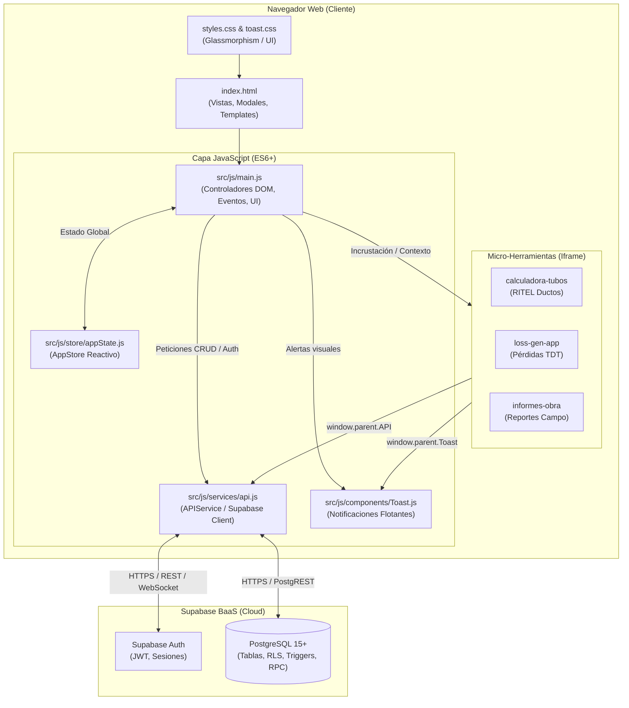
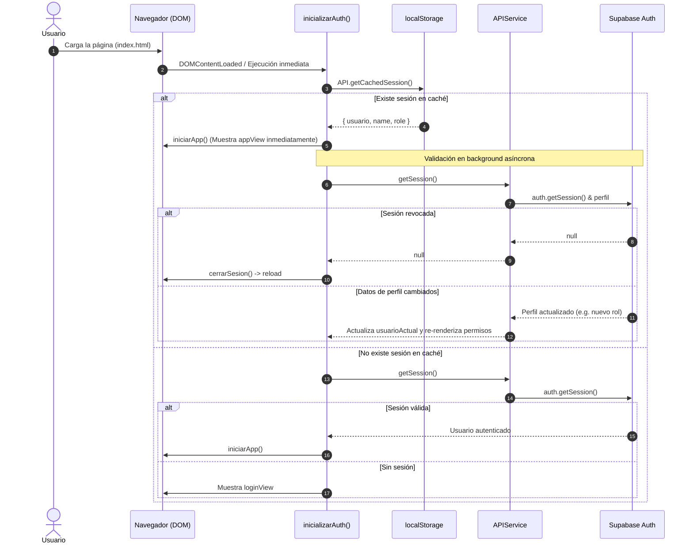

# 01. Arquitectura General del Sistema

> **Objetivo:** Explicar los fundamentos estructurales, flujo de ejecución y patrones de diseño utilizados en el cliente de **SCITIC Control de Proyectos**, permitiendo a cualquier desarrollador o IA entender cómo interactúan los componentes sin romper la reactividad ni los contratos de datos.

---

## 🏗️ 1. Diagrama de Arquitectura de Alto Nivel



---

## 📂 2. Estructura del Proyecto y Responsabilidades

```
📦 scitic-app
 ┣ 📂 assets/                     # Recursos gráficos estáticos
 ┃ ┗ 📜 logo.png                  # Logotipo oficial de SCITIC S.A.S. (usado en login, header y comprobantes)
 ┣ 📂 sql/                        # Definiciones DDL, scripts de migración, RLS y funciones PL/pgSQL
 ┃ ┣ 📜 crear_tabla_perfiles.sql  # Tabla perfiles, trigger handle_new_user y RLS
 ┃ ┣ 📜 crear_tabla_proyectos_calculadoras.sql # Tabla proyectos_calculadoras con RLS y JSONB
 ┃ ┣ 📜 actualizar_tabla_proyectos_resumen.sql  # Migración para añadir columna resumen
 ┃ ┗ 📜 rpc_validar_credenciales.sql           # Funciones RPC de autenticación y lectura segura
 ┣ 📂 src/
 ┃ ┣ 📂 css/
 ┃ ┃ ┣ 📜 styles.css              # Estilos principales, variables CSS, layout, modales y recibo
 ┃ ┃ ┗ 📜 toast.css               # Estilos del sistema de notificaciones toast
 ┃ ┣ 📂 js/
 ┃ ┃ ┣ 📂 components/
 ┃ ┃ ┃ ┗ 📜 Toast.js              # Clase Toast para alertas (success, error, warning, info)
 ┃ ┃ ┣ 📂 services/
 ┃ ┃ ┃ ┗ 📜 api.js                # APIService: cliente Supabase, métodos CRUD y autenticación
 ┃ ┃ ┣ 📂 store/
 ┃ ┃ ┃ ┗ 📜 appState.js           # AppStore: clase de gestión de estado centralizado
 ┃ ┃ ┗ 📜 main.js                 # Lógica de negocio, controladores de eventos, DOM y dashboards
 ┃ ┗ 📂 tools/                    # Aplicaciones técnicas independientes montadas en iframe
 ┃   ┣ 📂 calculadora-tubos/      # Dimensionamiento RITEL para torres y parcelaciones
 ┃   ┣ 📂 informes-obra/          # Registro técnico de instalaciones TDT en campo
 ┃   ┗ 📂 loss-gen-app/           # Calculadora de pérdidas y balance de radiofrecuencia/fibra
 ┣ 📂 wiki/                       # Documentación técnica completa (esta Wiki)
 ┣ 📜 index.html                  # Shell principal de la aplicación SPA
 ┗ 📜 README.md                   # Resumen del proyecto para repositorio
```

---

## ⚡ 3. El Patrón Store Reactivo (`appState.js`)

Para desacoplar el estado de la manipulación del DOM, el sistema implementa la clase `AppStore` instanciada en `window.Store`.

### Árbol de Estado (`state`)
```javascript
this.state = {
    datos: [],                             // Array con todos los registros de horas (public.registros)
    gastosDatos: [],                       // Array con todos los gastos y viáticos (public.gastos)
    auditoria: [],                         // Registros de auditoría recientes (public.auditoria)
    listaFiltradaGlobal: [],               // Registros de horas después de aplicar filtros activos
    alertasDetalladasGlobales: [],         // Proyectos que superan el presupuesto de horas
    editId: null,                          // ID del registro de horas en proceso de edición
    usuarioActual: null,                   // Objeto del usuario autenticado: { usuario, name, role }
    trabajadoresActivosParaPendientes: [], // Lista de colaboradores activos para cálculo de faltantes
    config: {
        meses: []
    }
};
```

### Puente de Retrocompatibilidad (`Object.defineProperty`)
Para evitar refactorizaciones masivas en código existente y permitir a la vez que cualquier escritura sea reactiva, en [`src/js/main.js`](file:///d:/SCITIC/SOFTWARE/scitic-app/src/js/main.js#L5-L13) se mapean las propiedades de `window`:

```javascript
Object.defineProperty(window, 'datos', { 
    get: () => window.Store.state.datos, 
    set: (v) => window.Store.setState({ datos: v }) 
});
Object.defineProperty(window, 'gastosDatos', { 
    get: () => window.Store.state.gastosDatos, 
    set: (v) => window.Store.setState({ gastosDatos: v }) 
});
Object.defineProperty(window, 'usuarioActual', { 
    get: () => window.Store.state.usuarioActual, 
    set: (v) => window.Store.setState({ usuarioActual: v }) 
});
```

> [!TIP]
> Al asignar `datos = nuevosDatos` en cualquier parte del código, automáticamente se invoca `Store.setState()` y se notifican los listeners registrados.

---

## 🔄 4. Ciclo de Vida e Inicialización

El arranque de la aplicación optimiza la velocidad percibida eliminando cualquier parpadeo de pantalla (*FOUC* o parpadeo del login):



---

## 🎛️ 5. Control de Vistas y Módulos Principales

La navegación principal no recarga la página, sino que conmuta entre contenedores HTML mediante la función `cambiarModulo(modulo)`:

```javascript
// main.js - Módulos disponibles
const modulos = [
    { name: 'horas', el: horasModule, tab: tabHoras },
    { name: 'gastos', el: gastosModule, tab: tabGastos },
    { name: 'herramientas', el: herramientasModule, tab: tabHerramientas }
];
```

* **Módulo de Horas (`horasModule`):** Panel de control de horas trabajadas, filtros, KPIs, formulario laboral/novedad, tabla de registros y gráficos.
* **Módulo de Gastos (`gastosModule`):** Control de viáticos, resumen de saldos a favor, tabla con selección múltiple y consola de liquidación.
* **Módulo de Herramientas (`herramientasModule`):** Catálogo de micro-herramientas con apertura suave en `iframe` y transiciones animadas estilo iOS/macOS.

---

## 🔐 6. Control de Acceso Basado en Roles (Frontend)

El sistema soporta 3 roles de usuario:
1. `colaborador`: Trabajador de campo o de ingeniería.
   - Solo ve sus propios registros y proyectos asignados.
   - No puede editar el valor/hora ni horas presupuestadas de los proyectos.
   - En gastos, el campo de beneficiario queda fijo con su nombre.
   - No tiene acceso a la consola de liquidación de pagos masivos ni a modificar saldos a favor.
2. `moderador`: Líder de proyecto o auditor operativo.
   - Visualiza datos de todo el personal.
   - Puede editar registros y proyectos.
   - Tiene acceso a los resúmenes y análisis completos.
3. `admin`: Administrador general de SCITIC.
   - Control total sobre horas, gastos, liquidación de pagos, saldos a favor y proyectos de herramientas.
   - Visualización de métricas financieras globales (desglose administrativo de costos).

La función `aplicarPermisos()` en [`src/js/main.js`](file:///d:/SCITIC/SOFTWARE/scitic-app/src/js/main.js) oculta o muestra dinámicamente los elementos de UI según el rol detectado en la sesión.
