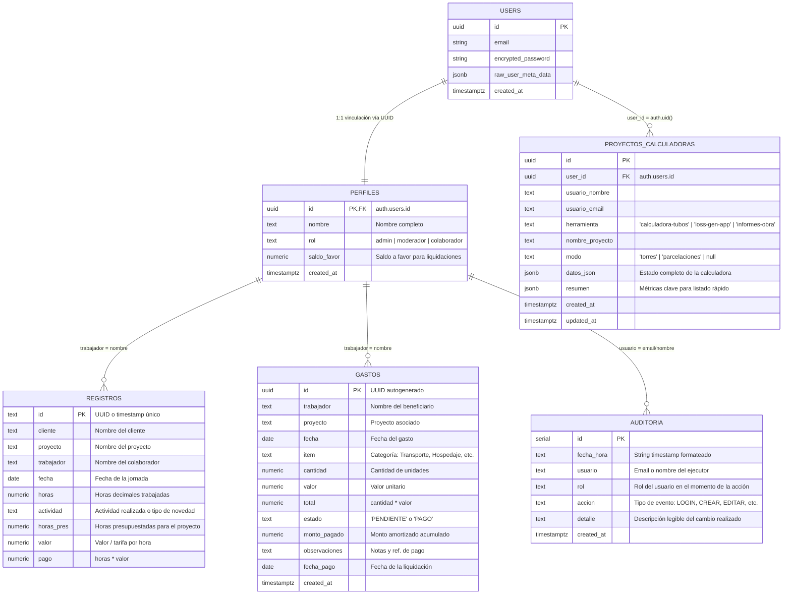

# 02. Base de Datos y Seguridad (Supabase & PostgreSQL)

> **Objetivo:** Documentar el modelo de datos relacional, las políticas de Row Level Security (RLS), las funciones almacenadas (RPC), los triggers y el modelo de seguridad que gobierna la base de datos PostgreSQL alojada en **Supabase**.

---

## 🗄️ 1. Diagrama Entidad-Relación (ER)



---

## 📋 2. Diccionario de Datos de las Tablas

### 2.1. Tabla `public.perfiles`
Extensión del usuario de autenticación (`auth.users`), creada automáticamente al registrarse.

| Columna | Tipo | Nulo | Default | Descripción |
|---|---|---|---|---|
| `id` | `UUID` | NO | - | Clave primaria referenciando `auth.users(id) ON DELETE CASCADE`. |
| `nombre` | `TEXT` | NO | - | Nombre y apellido del trabajador para asignaciones y reportes. |
| `rol` | `TEXT` | NO | `'colaborador'` | Rol del usuario: `'admin'`, `'moderador'` o `'colaborador'`. |
| `saldo_favor` | `NUMERIC` | SÍ | `0` | Saldo a favor disponible para compensar viáticos o amortizar pagos. |
| `created_at` | `TIMESTAMPTZ`| SÍ | `now()` | Fecha de registro. |

### 2.2. Tabla `public.registros`
Almacena las horas trabajadas y novedades reportadas en proyectos.

| Columna | Tipo | Nulo | Descripción |
|---|---|---|---|
| `id` | `TEXT` | NO | Identificador único (`reg_...` o UUID). |
| `cliente` | `TEXT` | SÍ | Cliente contratante (ej. "CLARO", "TIGO", "SCITIC S.A.S"). |
| `proyecto` | `TEXT` | NO | Nombre del proyecto de ingeniería u obra. |
| `trabajador` | `TEXT` | NO | Nombre del colaborador que ejecutó la labor. |
| `fecha` | `TEXT/DATE` | NO | Formato `YYYY-MM-DD`. |
| `horas` | `NUMERIC` | NO | Horas decimales (ej. 1.5 para 1h 30m, 8.0 para jornada completa). |
| `actividad` | `TEXT` | NO | Descripción del trabajo o concepto de novedad (ej. "DISEÑO", "VACACIONES"). |
| `horas_pres` | `NUMERIC` | SÍ | Presupuesto total de horas asignadas a este proyecto. |
| `valor` | `NUMERIC` | SÍ | Tarifa monetaria por hora estipulada para el costo del proyecto. |
| `pago` | `NUMERIC` | SÍ | Total liquidado: `horas * valor`. |

### 2.3. Tabla `public.gastos`
Control de viáticos, compras de materiales y consumos operativos en campo.

| Columna | Tipo | Nulo | Default | Descripción |
|---|---|---|---|---|
| `id` | `UUID/TEXT` | NO | `gen_random_uuid()` | ID primario del gasto. |
| `trabajador` | `TEXT` | NO | - | Beneficiario a quien se le adeuda o liquidó el gasto. |
| `proyecto` | `TEXT` | NO | - | Proyecto al que se carga el gasto operativo. |
| `fecha` | `DATE` | NO | - | Fecha de realización del gasto. |
| `item` | `TEXT` | NO | - | Categoría (Transporte, Alimentación, Hospedaje, Materiales, etc.). |
| `cantidad` | `NUMERIC` | NO | `1` | Número de unidades. |
| `valor` | `NUMERIC` | NO | `0` | Costo unitario. |
| `total` | `NUMERIC` | NO | `0` | Costo total (`cantidad * valor`). |
| `estado` | `TEXT` | NO | `'PENDIENTE'` | `'PENDIENTE'` (por pagar) o `'PAGO'` (liquidado). |
| `monto_pagado`| `NUMERIC` | SÍ | `0` | Suma pagada en abonos parciales. |
| `observaciones`| `TEXT` | SÍ | - | Comentarios adicionales y trazabilidad de comprobantes. |
| `fecha_pago` | `DATE/TEXT`| SÍ | - | Fecha en que se liquidó totalmente el ítem. |
| `created_at` | `TIMESTAMPTZ`| SÍ | `now()` | Fecha de creación del registro. |

### 2.4. Tabla `public.proyectos_calculadoras`
Almacena proyectos guardados desde las micro-herramientas técnicas.

| Columna | Tipo | Nulo | Default | Descripción |
|---|---|---|---|---|
| `id` | `UUID` | NO | `gen_random_uuid()` | ID único del proyecto de cálculo. |
| `user_id` | `UUID` | NO | `auth.uid()` | Usuario creador, referenciando `auth.users(id)`. |
| `usuario_nombre` | `TEXT` | NO | - | Nombre del usuario al guardar. |
| `usuario_email` | `TEXT` | NO | - | Email del usuario al guardar. |
| `herramienta` | `TEXT` | NO | - | `'calculadora-tubos'`, `'loss-gen-app'` o `'informes-obra'`. |
| `nombre_proyecto`| `TEXT` | NO | - | Nombre comercial del proyecto (ej. "Torre Barcelona"). |
| `modo` | `TEXT` | SÍ | - | Modo de cálculo (ej. `'torres'`, `'parcelaciones'`). |
| `datos_json` | `JSONB` | NO | - | Estado completo y matrices de datos de la calculadora. |
| `resumen` | `JSONB` | SÍ | `'{}'::jsonb` | Resumen ligero para previews y listados rápidos sin descargar todo el JSON. |
| `created_at` | `TIMESTAMPTZ`| SÍ | `now()` | Fecha de creación. |
| `updated_at` | `TIMESTAMPTZ`| SÍ | `now()` | Última modificación. |

### 2.5. Tabla `public.auditoria`
Log inmutable de auditoría para trazabilidad de acciones operativas sensibles.

| Columna | Tipo | Descripción |
|---|---|---|
| `id` | `SERIAL/UUID` | Clave primaria. |
| `fecha_hora` | `TEXT` | Fecha y hora legible formateada en hora colombiana. |
| `usuario` | `TEXT` | Identificador del usuario que realizó la acción. |
| `rol` | `TEXT` | Rol que ostentaba el usuario. |
| `accion` | `TEXT` | Código de acción (`LOGIN`, `CREACION`, `EDICION`, `ELIMINAR`, `NOVEDAD_RANGO`, `GASTO_CREAR`, `GASTO_EDITAR`, `GASTO_ELIMINAR`, `LIQUIDACION_PAGO`, `PROYECTO_CREAR`, `PROYECTO_EDITAR`, `PROYECTO_ELIMINAR`). |
| `detalle` | `TEXT` | Explicación detallada del cambio o valores modificados. |
| `created_at` | `TIMESTAMPTZ` | Timestamp generado por el servidor. |

---

## 🛡️ 3. Políticas de Seguridad (Row Level Security - RLS)

En PostgreSQL, el mecanismo **RLS** garantiza que ningún usuario pueda ver o modificar datos no autorizados, aun si manipula la consola JavaScript del navegador.

### 3.1. Función de Verificación de Privilegios (`es_admin_o_moderador()`)
Ubicada en [`sql/crear_tabla_proyectos_calculadoras.sql`](file:///d:/SCITIC/SOFTWARE/scitic-app/sql/crear_tabla_proyectos_calculadoras.sql#L27-L38):

```sql
CREATE OR REPLACE FUNCTION public.es_admin_o_moderador()
RETURNS BOOLEAN
LANGUAGE sql
SECURITY DEFINER
STABLE
AS $$
  SELECT EXISTS (
    SELECT 1 FROM public.perfiles
    WHERE id = auth.uid()
      AND rol IN ('admin', 'moderador')
  );
$$;
```

### 3.2. Políticas en `proyectos_calculadoras`
* **SELECT:** Los administradores y moderadores ven todos los proyectos guardados en el sistema. Los colaboradores solo pueden ver los proyectos que ellos mismos crearon (`user_id = auth.uid()`).
* **INSERT:** Permitido a cualquier usuario autenticado, siempre y cuando el campo `user_id` coincida con su propio `auth.uid()`.
* **UPDATE / DELETE:** Un colaborador solo puede actualizar o eliminar sus propios proyectos. Administradores y moderadores pueden gestionar cualquiera.

### 3.3. Políticas en `perfiles`
* **SELECT:** Todo usuario autenticado puede leer nombres y roles de la tabla `perfiles` (necesario para listas de selección y cálculo de métricas de personal).
* **INSERT / UPDATE:** Administrado mediante triggers o restringido a administradores.

---

## ⚙️ 4. Triggers y Funciones RPC

### 4.1. Trigger `handle_new_user` (Creación automática de perfil)
Ubicado en [`sql/crear_tabla_perfiles.sql`](file:///d:/SCITIC/SOFTWARE/scitic-app/sql/crear_tabla_perfiles.sql#L31-L52):

```sql
CREATE OR REPLACE FUNCTION public.handle_new_user()
RETURNS TRIGGER
LANGUAGE plpgsql
SECURITY DEFINER SET search_path = public
AS $$
BEGIN
    INSERT INTO public.perfiles (id, nombre, rol)
    VALUES (
        NEW.id,
        COALESCE(NEW.raw_user_meta_data->>'nombre', split_part(NEW.email, '@', 1)),
        COALESCE(NEW.raw_user_meta_data->>'rol', 'colaborador')
    );
    RETURN NEW;
END;
$$;
```
Cada vez que un usuario es dado de alta en Supabase Auth, se crea de forma atómica su correspondiente perfil en `public.perfiles`.

### 4.2. Función RPC `validar_credenciales`
Ubicada en [`sql/rpc_validar_credenciales.sql`](file:///d:/SCITIC/SOFTWARE/scitic-app/sql/rpc_validar_credenciales.sql#L8-L38). Permite validar contraseñas de forma segura del lado del servidor retornando `{ valido, nombre, rol }` sin transferir hashes o contraseñas al cliente.

---

## ⚡ 5. Índices de Rendimiento Recomendados

Para mantener tiempos de respuesta en milisegundos a medida que crecen los registros:

```sql
-- Índices para búsqueda rápida en herramientas
CREATE INDEX IF NOT EXISTS idx_proyectos_calculadoras_herramienta 
    ON public.proyectos_calculadoras(herramienta, updated_at DESC);

CREATE INDEX IF NOT EXISTS idx_proyectos_calculadoras_user 
    ON public.proyectos_calculadoras(user_id);

-- Índices para filtros frecuentes en registros de horas
CREATE INDEX IF NOT EXISTS idx_registros_fecha_proyecto 
    ON public.registros(fecha DESC, proyecto);

CREATE INDEX IF NOT EXISTS idx_registros_trabajador 
    ON public.registros(trabajador);

-- Índices para módulo de gastos
CREATE INDEX IF NOT EXISTS idx_gastos_estado_trabajador 
    ON public.gastos(estado, trabajador);
```
