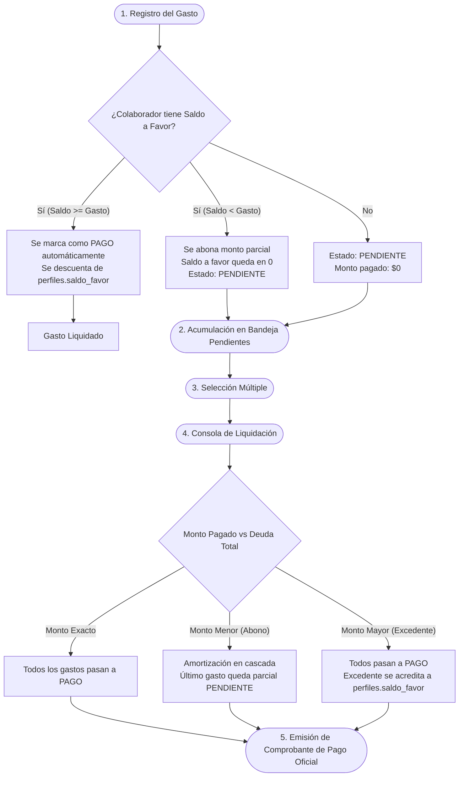

# 04. Módulo de Gastos, Viáticos y Liquidaciones

> **Objetivo:** Documentar el flujo operativo y financiero para la gestión de compras operativas, viáticos de campo, pagos a colaboradores, compensación automática de saldos a favor y emisión de recibos oficiales en **SCITIC S.A.S.**

---

## 💸 1. Ciclo de Vida de un Gasto



---

## 📝 2. Registro y Estructura de Datos

El formulario de gastos ([`#formularioGasto`](file:///d:/SCITIC/SOFTWARE/scitic-app/src/js/main.js#L1719-L1815)) calcula en tiempo real:
$$\text{Total} = \text{Cantidad} \times \text{Valor Unitario}$$

### Categorías / Ítems de Gasto Disponibles
* `Transporte / Pasajes`
* `Combustible`
* `Peajes`
* `Alimentación`
* `Hospedaje`
* `Materiales / Ferretería`
* `Imprevistos / Otros`

### Trazabilidad y Seguridad
* Si el usuario es un `colaborador`, el campo de beneficiario queda bloqueado con su propio nombre.
* No se permite registrar gastos con total en cero o sin proyecto asignado.
* Cada nuevo registro queda guardado en la tabla PostgreSQL `public.gastos`.

---

## ☑️ 3. Sistema de Selección Múltiple y Barra Flotante

En la tabla de gastos, cada fila cuenta con un checkbox interactivo.

### Comportamiento de la Selección
* El conjunto de IDs seleccionados se almacena en `window.gastosSeleccionadosIds` (`Set<UUID>`).
* El checkbox de cabecera (`#selectAllGastos`) permite marcar o desmarcar todos los gastos visibles con un solo clic.
* Al seleccionar uno o más gastos, emerge desde la parte inferior de la pantalla la **Barra Flotante de Acciones** (`#barraSeleccionGastos`), mostrando:
  * **Contador:** Número de gastos seleccionados.
  * **Suma Acumulada:** Total adeudado en moneda colombiana (`$ COP`).
  * **Botón de Liquidación:** Abre la consola de pago guiado con los ítems pre-cargados.
  * **Botón de Deselección:** Limpia la selección activa.

---

## 🏛️ 4. La Consola de Liquidación y Saldo a Favor

Ubicada en el modal `#modalLiquidacion`, permite a los administradores registrar transferencias o pagos de tesorería.

### 4.1. Concepto de "Saldo a Favor" (`perfiles.saldo_favor`)
Si la empresa gira un anticipo de \$500.000 COP a un trabajador que solo tiene reportados \$350.000 COP en gastos:
1. Los \$350.000 COP de gastos se marcan como `PAGO`.
2. El remanente de \$150.000 COP **no se pierde**: se almacena automáticamente en la columna `saldo_favor` del trabajador en la tabla `public.perfiles`.
3. Cuando ese trabajador registre nuevos gastos en días posteriores, el sistema consumirá prioritariamente ese saldo a favor antes de generar una nueva cuenta por pagar.

### 4.2. Algoritmo de Liquidación en Cascada
Cuando el administrador procesa un pago con un monto determinado:

```javascript
// main.js - Algoritmo de amortización
let saldoDisponible = montoPagado;

for (const gastoObj of gastosALiquidar) {
    if (saldoDisponible <= 0) break;
    let deudaActual = Number(gastoObj.total || 0) - Number(gastoObj.monto_pagado || 0);

    if (saldoDisponible >= deudaActual) {
        // Cubre el gasto completo
        saldoDisponible -= deudaActual;
        await window.API.actualizarGasto(gastoObj.id, {
            estado: 'PAGO',
            fecha_pago: fechaPago,
            monto_pagado: gastoObj.total,
            observaciones: nuevaObservacionConComprobante
        });
    } else {
        // Cubre parcialmente el gasto
        const nuevoMonto = Number(gastoObj.monto_pagado || 0) + saldoDisponible;
        saldoDisponible = 0;
        await window.API.actualizarGasto(gastoObj.id, {
            estado: 'PENDIENTE',
            monto_pagado: nuevoMonto,
            observaciones: nuevaObservacionConComprobante
        });
    }
}

// Si sobró dinero después de cubrir todos los gastos seleccionados
if (saldoDisponible > 0) {
    saldoFavorNuevo += saldoDisponible;
    await window.API.actualizarSaldoFavor(trabajador, saldoFavorNuevo);
}
```

---

## 🧾 5. Comprobante de Pago Oficial Imprimible

Una vez confirmada la liquidación, el sistema genera automáticamente un **Comprobante de Pago** en el modal `#modalReciboPago` con estilos optimizados para impresión física o guardado en PDF:

### Elementos del Comprobante:
1. **Encabezado Corporativo:** Razón social: *SCITIC S.A.S.*, NIT: *901.458.120-1*.
2. **Metadatos:** Número de comprobante consecutivo o de referencia bancaria, fecha de expedición, método de pago (Transferencia Bancolombia, Nequi, Daviplata, Efectivo).
3. **Beneficiario:** Nombre completo del trabajador y notas u observaciones de tesorería.
4. **Tabla de Desglose:** Lista numerada de los gastos cubiertos, proyectos a los que pertenecían y monto liquidado por cada ítem.
5. **Caja de Totales:** Total pagado y valor acreditado como saldo a favor (si hubo excedente).
6. **Sección de Firmas:** Espacio formal para *"Autorizado Por (SCITIC)"* y *"Recibí Conforme (Beneficiario)"*.

> [!TIP]
> Al presionar `Ctrl + P` o hacer clic en "Imprimir Recibo", las reglas CSS `@media print` ocultan todos los menús de navegación, botones y barras de scroll, dejando únicamente el comprobante en hoja blanca limpia.
